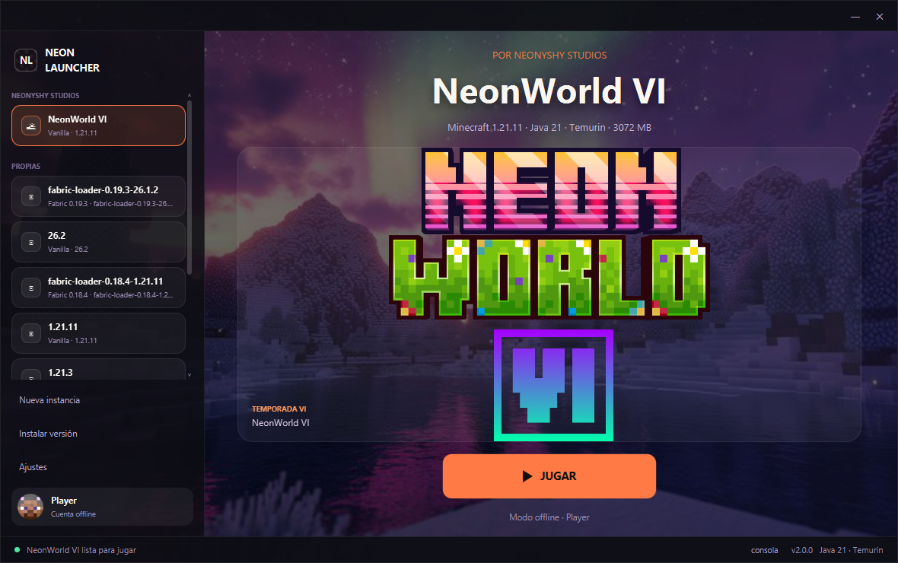
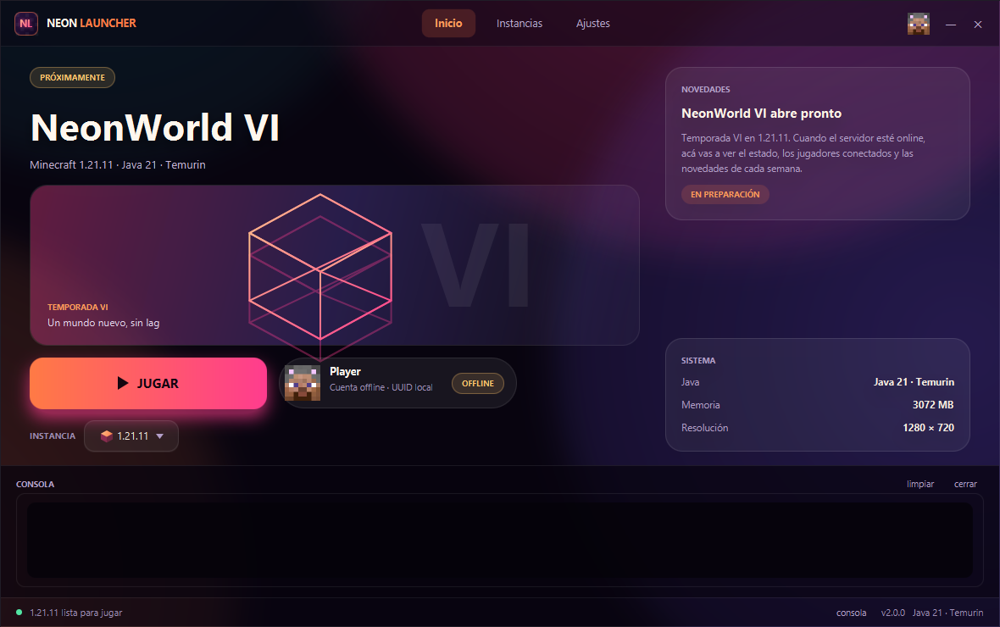

# NeonLauncher 2.0

Launcher de Minecraft de escritorio en **Kotlin + JavaFX 21**, reescrito desde cero.

La versión anterior era un esqueleto que no compilaba ni arrancaba (ver
[`AUDITORIA.md`](AUDITORIA.md), que describe *ese* estado). Esta versión **compila, abre y
lanza Minecraft de verdad** en modo offline, usando una instalación existente.



---

## Qué hace hoy

| | |
|---|---|
| ✅ | Detecta las versiones instaladas en `.minecraft` (vanilla, Fabric, Forge, Quilt). |
| ✅ | Resuelve la herencia de versiones (Fabric → su versión base) y arma el classpath real. |
| ✅ | Filtra librerías y argumentos por `rules` (SO, arquitectura, features). |
| ✅ | Lanza Minecraft **offline**: `accessToken` simbólico y UUID derivado del nombre. |
| ✅ | Detecta los JDK de la máquina y avisa si la versión elegida pide uno más nuevo. |
| ✅ | Consola en vivo con la salida del juego y botón para cerrarlo. |
| ✅ | Mods: lista, busca y activa/desactiva (`.jar` ↔ `.jar.disabled`). |
| ✅ | Ventana **frameless** con barra de título propia y piel fija "NeonWorld VI". |
| ✅ | Config persistente en `%APPDATA%\NeonLauncher\settings.json`. |
| ❌ | Login de Microsoft y juego online (queda el seam preparado). |
| ❌ | Descarga de versiones/librerías/assets faltantes. |
| ❌ | Instancias separadas con su propia carpeta `mods`. |



---

## Requisitos

- **JDK 21** (probado con Temurin 21.0.12). Para versiones de Minecraft 26.x hace falta **JDK 25**;
  el launcher lo detecta y lo dice en pantalla.
- **Una instalación de Minecraft** del launcher oficial (`%APPDATA%\.minecraft`). El launcher no
  descarga el juego: usa los JSON de versión, las librerías y los assets que ya están ahí.
- Gradle no hace falta instalarlo: está el wrapper (8.5).

```powershell
$env:JAVA_HOME = "C:\Program Files\Eclipse Adoptium\jdk-21.0.12.101-hotspot"
.\gradlew.bat build              # compila los 3 módulos y corre los tests
.\gradlew.bat :launcher-ui:run   # abre el launcher
```

En Linux/macOS los mismos comandos con `./gradlew`.

---

## Arquitectura

```
launcher-ui  ──▶  launcher-core  ──▶  launcher-common
  (JavaFX)         (lógica)            (modelos y utilidades)
```

`launcher-core` expone `launcher-common` con `api`, así la UI ve los modelos sin declararlos de
nuevo (el error de visibilidad que tenía la versión 1).

### `launcher-common`
- `model/LauncherSettings.kt` — configuración + `Theme` + `sealed interface Account`
  (`Offline` hoy, `Microsoft` cuando toque).
- `model/PlayerProfile.kt` — validación de nombre y UUID offline (`OfflinePlayer:<nombre>`).
- `util/Json.kt` — `ObjectMapper` único (Jackson + Kotlin module).
- `util/Environment.kt` — rutas por SO, familias de SO, `formatBytes`.
- `util/AppInfo.kt` — nombre y versión.

### `launcher-core`
| Archivo | Rol |
|---|---|
| `game/VersionJson.kt` | Modelo del `version.json` (librerías, rules, arguments, logging…). |
| `game/VersionStore.kt` | Lectura de los JSON en disco y cadena de herencia. |
| `game/InstallationScanner.kt` | Detecta qué versiones se pueden lanzar. |
| `game/VersionResolver.kt` | Merge de herencia, classpath, natives, argumentos. |
| `game/Rules.kt` | Evaluación de `rules` y extracción de natives (versiones viejas). |
| `game/GameLauncher.kt` | Arma la línea de comandos, sustituye placeholders y lanza el proceso. |
| `runtime/JavaFinder.kt` | Busca JDKs y elige el más chico que cumpla el requisito. |
| `mods/ModRepository.kt` | Lista y activa/desactiva mods. |
| `settings/SettingsStore.kt` | Persistencia de la configuración. |

### `launcher-ui`
UI **programática** (sin FXML), un archivo por pieza:

- `NeonApp.kt` — ventana frameless, estado global, ciclo de lanzamiento y drawer de consola.
- `TitleBar.kt` — barra propia: arrastrar, minimizar, cerrar y navegación.
- `Brand.kt` — isotipo "NL", wordmark y cubos (isotipo, wireframe y textura de bloques).
- `Skin.kt` — aplica la piel fija `css/app.css`.
- `PlayView.kt` — hero con estado, JUGAR y tarjetas de instancia/sistema.
- `InstancesView.kt` — versiones instaladas para elegir la activa.
- `SettingsView.kt` — carpeta, Java, memoria, resolución, JVM args.
- `Types.kt` — vistas, fases, buffer de consola y helpers de layout.

**Por qué así:** la piel es una sola hoja literal (`css/app.css`) porque el motor CSS de JavaFX no
soporta variables y el launcher tiene identidad fija de NeonWorld. Los FXML de la 1.x usaban
`<StatusBar>`, `Spinner initialValue` y `ModActionCellFactory`, que no existen: la UI en código
elimina esa clase entera de fallos.

---

## Cómo lanza Minecraft (modo offline)

1. Lee `<.minecraft>/versions/<id>/<id>.json` y sigue `inheritsFrom` hasta la raíz.
2. Junta las librerías (el hijo pisa al padre), filtra por `rules` y resuelve la ruta Maven
   (`downloads.artifact.path` o derivada del `group:artifact:version[:classifier]`).
3. Suma el jar del cliente: el de la versión base y/o el propio del loader.
4. Sustituye los placeholders (`${auth_player_name}`, `${assets_root}`, `${classpath}`, …) y arma
   `java <jvm args> -cp <classpath> <mainClass> <game args>`.
5. Lanza el proceso, usa el `.minecraft` como working dir y transmite la salida a la consola.

El token es `0` y el UUID sale de `OfflinePlayer:<nombre>`: es exactamente lo que Minecraft usa en
singleplayer. Los errores de *Realms / user properties* que aparecen en la consola (HTTP 401) son
esperables sin cuenta; el juego arranca igual.

---

## Configuración y datos

| Qué | Dónde |
|---|---|
| Configuración | `%APPDATA%\NeonLauncher\settings.json` |
| Natives extraídas | `<.minecraft>\neonlauncher\natives\<versión>` |

---

## Banderas de desarrollo

Sirven para probar sin tocar la UI (las usé para las capturas):

| Variable | Efecto |
|---|---|
| `NEON_SCREENSHOT=<ruta.png>` | Toma una captura de la ventana y cierra. |
| `NEON_DELAY=<ms>` | Espera antes de la captura (default 1600). |
| `NEON_VIEW=play\|mods\|settings` | Vista inicial (para capturar otra pantalla). |
| `NEON_VERSION=<id>` | Fuerza la versión seleccionada. |
| `NEON_AUTOPLAY=1` | Aprieta JUGAR al terminar de cargar. |
| `NEON_VERBOSE=1` | Imprime en stdout la línea de comandos y la salida del juego. |

---

## Próximos pasos

1. **Login de Microsoft** (device code + refresh) y `Account.Microsoft` en el flujo de lanzamiento.
2. **Descarga de versiones**: `version_manifest_v2.json`, librerías, asset index y objects.
3. **Descarga de Java** (el runtime oficial de Mojang) cuando la versión pide 25 y no está.
4. **Instancias**: carpeta de juego propia por instancia, para que los mods de 26.1.2 no choquen
   con un 1.21.11 (hoy el `mods/` es único, como en el launcher oficial).
5. Tests de integración del resolver contra un `.minecraft` de fixture.

> `AUDITORIA.md` y `PROPUESTAS.md` son documentos **históricos** de la versión 1.x: sirven como
> registro de los problemas encontrados, no describen este código.
